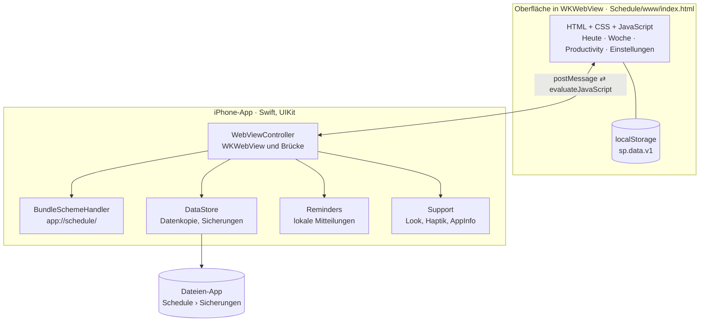

# Schedule 4.0 – Überblick für Entwickler

Schedule ist eine private Stundenplan-App fürs iPhone: eine feste **Master-Woche** aus wiederkehrenden Blöcken („Blocker“),
dazu Abweichungen pro Tag, To-Dos und eine kleine Statistik. Die App ist nicht im App Store, sie wird per Sideloading
aufs eigene iPhone geladen. Sie braucht kein Internet, hat keinen Server und keine Abhängigkeiten von Drittanbietern.

> **Wichtig beim Öffnen des Repos:** Der Standard-Zweig ist `gh-pages` (die alte Web-App 3.3.0).
> Der Code der iPhone-App liegt im Zweig **`ios-app`**, also hier.

| | |
|---|---|
| Version | 4.0.0 (Build 1), Datenformat `DATA_V = 5` |
| Plattform | iOS 17 oder neuer, nur iPhone, nur Hochformat |
| Kennung | `io.github.trolloberg.schedule` |
| Sprachen | Swift (UIKit, Swift-5-Sprachmodus) und HTML/CSS/JavaScript ohne Framework |
| Abhängigkeiten | keine (kein CocoaPods, kein SPM, kein npm in der App) |
| Gebaut mit | Xcode 26.6, iOS-SDK 26.5, Swift 6.3 auf GitHub Actions (`macos-latest`) |
| Tests | 778 automatische Prüfungen der Oberfläche (Playwright) und 13 Starts im Simulator |

## Wo anfangen?

1. Dieses Dokument (Architektur, Brücke, Datenmodell).
2. [`Schedule/WebViewController.swift`](Schedule/WebViewController.swift): das Herz der iPhone-Hülle.
3. [`web-src/p2_core.js`](web-src/p2_core.js): Datenmodell, Laden und Speichern, Brücke auf der JavaScript-Seite.
4. [`web-src/p7_app.js`](web-src/p7_app.js): Mitteilungen, Backup und der Start der Oberfläche (ganz unten).
5. [`.github/workflows/ios.yml`](.github/workflows/ios.yml): wie die App ohne eigenen Mac gebaut wird.

## Architektur

Schedule ist eine **Hybrid-App**: Eine schlanke native Hülle in Swift zeigt die Oberfläche in einer `WKWebView`.
Die Oberfläche ist eine einzige, gebündelte Datei (`Schedule/www/index.html`), die im App-Paket liegt.
Was eine Webseite nicht kann (lokale Mitteilungen, Dateien, Teilen-Menü, Haptik, Statusleiste), erledigt die Hülle über eine Nachrichten-Brücke.



Gestartet wird über `AppDelegate` → `SceneDelegate` → `WebViewController`.

**Warum so gebaut?** Schedule war bis 3.3 eine Web-App (PWA). Für 4.0 wurde derselbe Code in eine echte App gepackt,
statt alles neu zu schreiben. Dieselben Quellen laufen weiterhin im Browser: Dort ist `NATIVE` falsch und die Brücke wird nicht benutzt.

### Ablauf beim Start

1. `SceneDelegate` setzt Fensterfarbe und Hell/Dunkel des letzten Starts (kein weißes Aufblitzen) und erzeugt den `WebViewController`.
2. Sobald die Safe-Area-Ränder bekannt sind (`viewDidLayoutSubviews`), ruft er `loadApp()` auf und legt ein Skript an, das **vor** jedem anderen Skript der Seite läuft:
   `window.__nativeBoot = { info: { version, build, lang, ios, exp, safe: {t, b} }, env: "<letzte Datenkopie>" }`.
3. Die `WKWebView` lädt `app://schedule/index.html`. Der `BundleSchemeHandler` liefert die Datei aus dem Ordner `www` im App-Paket.
   Das eigene Schema sorgt für eine feste Herkunft, damit `localStorage` erhalten bleibt (bei `file://` wäre das nicht verlässlich).
4. `load()` in `p2_core.js` vergleicht den Web-Speicher (`sp.data.v1`, Zeitstempel `sp.mod`) mit der Kopie der App (`env.mod`). Der neuere Stand gewinnt.
   Alte Formate (v1 bis v4) werden dabei mit `migrate()` ins aktuelle Format gebracht.
5. Die Seite meldet `ready`. Die Hülle blendet die bis dahin unsichtbare Web-Ansicht ein.
   Meldet sich die Seite nicht, zeigt die Hülle sie nach 1,5 s trotzdem und lädt nach 10 s neu (höchstens zwei weitere Versuche).
6. Bei jedem `save()` schreibt die Oberfläche in den Web-Speicher **und** schickt den Stand an die App (`save`), die ihn in eine Datei schreibt.

### Die Brücke

Oberfläche → App: `post(t, …)` in `p2_core.js` ruft `window.webkit.messageHandlers.schedule.postMessage({ t, … })` auf.
Die App nimmt nur Nachrichten aus dem Hauptframe mit Schema `app` an.

| `t` | Felder | Was die App tut |
|---|---|---|
| `ready` | `v` | Oberfläche steht: einblenden, ggf. „Heute“ öffnen, Prüfskript (nur Debug) |
| `save` | `mod`, `env` | Datenkopie und Tagessicherung schreiben (`DataStore`) |
| `bar` | `bg`, `light`, `theme` | Hintergrund hinter der Seite und Farbe der Statusleiste |
| `haptic` | `k` (`sel`, `light`, `medium`, `ok`, `warn`) | Tippgefühl |
| `notify` | `on`, `ask`, `rid`, `plan[]`, `hint` | geplante Mitteilungen komplett ersetzen (`Reminders`) |
| `notifyTest` | `title`, `body` | Test-Mitteilung in 5 Sekunden |
| `export` | `name`, `text` | Backup-Datei schreiben und Teilen-Menü öffnen |
| `copy` | `text` | Zwischenablage |
| `settings` | | Mitteilungs-Einstellungen von iOS öffnen |
| `backups` | | Dateien-App im Ordner „Sicherungen“ öffnen |
| `reload` | | Oberfläche neu laden |
| `log` | `m` | Zeile ins Prüfprotokoll (nur Debug) |

App → Oberfläche: `evaluateJavaScript`, Werte immer als JSON (nie als zusammengesetzter Text).

| Aufruf | Wann |
|---|---|
| `window.__nativeBoot` | vor dem ersten Skript (siehe oben) |
| `__nativeResume()` | App ist wieder im Vordergrund oder die Uhrzeit hat sich sprunghaft geändert |
| `__nativeNotify({status, granted, n, until, rid})` | Ergebnis eines Mitteilungs-Abgleichs |
| `__nativeGo('day')` | eine Mitteilung wurde angetippt |
| `__nativeExported(bool)` | Teilen-Menü wurde geschlossen |
| `__nativeBackups(false)` | Dateien-App ließ sich nicht öffnen |

### Speicherung und Sicherungen

| Ort | Inhalt |
|---|---|
| `localStorage` `sp.data.v1` + `sp.mod` | Hauptstand der Oberfläche und Zeitstempel |
| `Application Support/Schedule/daten.json` | Kopie der App, wird beim Start mitgegeben |
| `Documents/Sicherungen/schedule-JJJJ-MM-TT.json` | eine Sicherung pro Tag, die letzten 14 (in der Dateien-App sichtbar) |
| `Documents/Sicherungen/schedule-…-HHMM-vorher.json` | alter Stand, wenn der neue plötzlich weniger als halb so groß ist (die letzten 3) |

Alle Dateien haben das Format eines Backups und lassen sich über „Backup laden“ wieder einlesen:
`{"app":"schedule","version":"4.0.0","mod":<ms>,"data":{…}}`. Geschrieben wird im Hintergrund auf einer eigenen Queue,
beim Wechsel in den Hintergrund wartet `flush()`, bis alles auf der Platte ist.

### Mitteilungen

Lokale Mitteilungen (`UNCalendarNotificationTrigger`), kein Push-Server. iOS hält höchstens 64 geplante Mitteilungen pro App.
Die Oberfläche berechnet bei jedem Öffnen und nach jeder Änderung die nächsten Termine (bis 28 Tage, `notifyPlan()`),
schickt höchstens 59 Mitteilungen (Termine plus bis zu 3 Hinweise vor dem Ablauf der Signatur) und dahinter einen Hinweis „bitte öffnen“. `Reminders` ersetzt den alten Plan
(Kennungen `plan.*`) komplett. Abgleiche laufen nacheinander auf einer eigenen Queue, damit sich zwei nicht vermischen.

### Ablauf der Signatur

Mit einer kostenlosen Apple-ID läuft eine selbst geladene App 7 Tage. `AppInfo.expiry` liest das Datum aus
`embedded.mobileprovision` (`ExpirationDate`), die Oberfläche zeigt es unter Einstellungen › Über Schedule und warnt zwei Tage vorher.

## Datenmodell (`DATA_V = 5`)

Beschrieben am Anfang des Abschnitts „Daten“ in [`web-src/p2_core.js`](web-src/p2_core.js). Gekürztes Beispiel:

```jsonc
{
  "v": 5,
  // Master-Woche: wiederkehrende Blocker, days 1 = Montag … 7 = Sonntag, rt = To-Dos bei jedem Termin
  "slots": [{ "id": "m3k9a1", "title": "Training", "desc": "", "start": "18:00", "end": "19:30",
              "days": [2, 4], "color": "green", "icon": "barbell", "rt": [{ "id": "r1", "title": "Tasche packen" }] }],
  // Abweichungen nur für ein Datum: s = geänderte oder ausfallende Blocker, x = Blocker nur an diesem Tag
  "ov":   { "2026-11-17": { "s": { "m3k9a1": { "skip": 1 } }, "x": [] } },
  // abgehakte wiederkehrende To-Dos: chk[Datum][Termin-Id][To-Do-Id] = 1
  "chk":  { "2026-11-13": { "m3k9a1": { "r1": 1 } } },
  // offene einmalige To-Dos (erledigte werden gelöscht und nur gezählt), at = einem Termin zugeordnet
  "todos": [{ "id": "t7", "title": "Rechnung zahlen", "note": "", "prio": 2, "due": null,
              "at": { "date": "2026-11-14", "slot": "m3k9a1" }, "created": 1794560000000, "done": false, "doneAt": null }],
  // wiederkehrende To-Dos nur an einem Tag anders (t) oder entfernt (x)
  "rto":  {},
  // Wochenbewertungen aus 3.2, werden nur aufbewahrt
  "rev":  {},
  // Zähler erledigter To-Dos: gesamt und pro Tag (ein Jahr)
  "stat": { "n": 42, "d": { "2026-11-13": 3 } },
  "set":  { "theme": "auto", "lang": "auto", "clock": "auto", "ws": 1, "snap": 15, "dur": 60, "dayS": 7, "dayE": 23,
            "push": { "on": 0, "url": "", "lead": 0, "exp": 0 }, "tut": 3 }
}
```

Grundidee: Die Master-Woche wird beim Bearbeiten einer konkreten Woche **nie** verändert. Änderungen landen als Abweichung in `ov[Datum]`.
`occ(datum)` setzt daraus die Termine eines Tages zusammen (mit Zwischenspeicher `OCC`, der bei jedem `save()` geleert wird).

## Die Oberfläche (`web-src/`)

Die Oberfläche ist reines HTML, CSS und JavaScript ohne Framework und ohne Build-Werkzeug. [`web-src/build.py`](web-src/build.py) hängt die Teile
in fester Reihenfolge aneinander, setzt die Symbole ein und schreibt `Schedule/www/index.html`.

> `Schedule/www/index.html` wird erzeugt. Änderungen immer in `web-src/` machen und danach `python3 web-src/build.py` ausführen.
> Der Bau auf GitHub führt `build.py` ohnehin vorher aus.

| Datei | Zeilen | Inhalt |
|---|---:|---|
| `p1_head.html` | 603 | HTML-Gerüst, das gesamte CSS (iOS-Stil, Glas-Effekte, Hell/Dunkel), kleine Start-Skripte (Theme vor dem ersten Bild, Safe-Area-Ränder, Notbremse mit „Neu laden“) |
| `p2_core.js` | 408 | Version, Brücke (`NB`, `NATIVE`, `post`), Sprache DE/EN, Symbole, Farben, Datum und Zeit, Datenmodell, `migrate()`, `load()`, `save()`, Termine eines Tages (`occ`), To-Do-Logik |
| `p3_ui.js` | 285 | UI-Grundlagen: Tabs, Blätter (Sheets), Menüs, Hinweise mit Rückgängig, Zeichnen (`render`, `softRender`, `morph`), Selbstheilung (`heal`), Fehlerprotokoll |
| `p4_views.js` | 388 | Ansichten: Heute (Vollbild mit Countdown-Ring), ganzer Tag, Woche (Raster), Einstellungen, Mitteilungen |
| `p4b_prod.js` | 95 | Tab „Productivity“: erledigte To-Dos pro Woche, offene To-Dos, Zuordnen zu Blockern |
| `p5_edit.js` | 569 | Bearbeiten-Modus der Woche: lange drücken, ziehen, Länge ändern, duplizieren, teilen, löschen, Platz machen, Rückgängig/Wiederholen |
| `p6_sheets.js` | 370 | Blätter: Details eines Blockers, Blocker-Editor, Ausfallen lassen, To-Do-Blatt, Auswahllisten |
| `p7_app.js` | 495 | Mitteilungen (Web-Push im Browser, lokale Mitteilungen in der App), Ablauf-Hinweis, Einführung, Backup, Beispieldaten, Wischen zwischen Wochen, Uhr-Takt, Rückkehr aus dem Hintergrund, Start |
| `icons.js` | 3 | Symbole (Ionicons 7.4.0, MIT-Lizenz) als SVG-Pfade |

**Regeln für Stabilität** (aus Fehlern in 3.x gelernt): Zeitgesteuerte Aktualisierungen nur über `softRender`/`morph` und nie, solange
`busy()` wahr ist (Finger auf dem Bildschirm, Scrollen). `heal()` ohne `display:none`. Beim Ziehen `lockY` statt einer Overflow-Sperre.

## Bauen

### Auf GitHub (ohne Mac)

[`.github/workflows/ios.yml`](.github/workflows/ios.yml) läuft bei jedem Push auf `ios-app` (außer reinen `.md`-Änderungen oder `[skip ci]`)
oder von Hand unter **Actions › iOS-App bauen › Run workflow**. Ein Lauf dauert etwa 15 Minuten.

1. Oberfläche aus `web-src/` bauen.
2. App für den Simulator bauen (Debug).
3. App-Datei fürs iPhone bauen (Release, arm64, **unsigniert**) und als `Schedule.ipa` packen.
4. Ergebnis sofort im Zweig `ios-build` ablegen ([`ci/ablegen.sh`](ci/ablegen.sh)).
5. Simulator „iPhone 17 Pro“ starten und die App mehrmals starten und prüfen ([`ci/simtest.sh`](ci/simtest.sh), Prüfskripte `ci/t*.js`).
   Weil der Simulator auf GitHub manchmal hängt, läuft jede Prüfung losgelöst mit fester Zeitgrenze ([`ci/wachhund.sh`](ci/wachhund.sh)).
6. Bildschirmfotos und Protokolle erneut in `ios-build` ablegen.

Signiert wird die App erst beim Laden aufs iPhone (z. B. mit Sideloadly und einer Apple-ID). Schritt für Schritt: [`ANLEITUNG.md`](ANLEITUNG.md).

### Auf einem Mac mit Xcode

`Schedule.xcodeproj` öffnen, unter *Signing & Capabilities* das eigene Team wählen, iPhone anschließen, ▶ drücken.
In Debug-Builds lässt sich die Web-Ansicht mit Safari untersuchen (`isInspectable`).

### Oberfläche im Browser und Tests

Die Oberfläche läuft auch in jedem Browser (dann ohne App-Funktionen). Die Tests brauchen Node.js und Playwright (`npm i playwright`, `npx playwright install chromium`)
und erwarten die Seite unter `http://localhost:8099/stundenplan/`. Im Browser-Modus meldet sich die Seite als Web-App an, deshalb kommen
Service Worker, Manifest und Symbole aus dem Zweig `gh-pages` dazu (sonst schlägt die Prüfung „keine Fehler in der Konsole“ an):

```bash
W=/tmp/www/stundenplan
mkdir -p $W /tmp/claude-0/shots33 /tmp/claude-0/shots40   # in shots33/40 legen die Tests Bildschirmfotos ab
python3 web-src/build.py $W/index.html
cp Schedule/www/apple-touch-icon.png $W/
git fetch origin gh-pages
for f in sw.js manifest.webmanifest icon-192.png icon-512.png; do git show origin/gh-pages:$f > $W/$f; done
(cd /tmp/www && python3 -m http.server 8099) &
node web-src/tests/tnative.js                    # gibt am Ende "pass N fail M" aus
```

So nachgeprüft am 13.11.2026: `tnative` 115/115, `t33` 86/86, `t32` 47/47, `tedit` 58/58, `tmove` 63/63, `tboot` 2/2.
`tstab` läuft länger als sechs Minuten. `tfull.js` braucht zusätzlich Backup-Dateien unter `/tmp/claude-0/`, und `tmigrate.js` die alte Web-App 3.3.0
(Adresse über die Umgebungsvariable `OLD`). Beide sind auf die Umgebung zugeschnitten, in der die App entstanden ist.

| Test | Prüfungen | Thema |
|---|---:|---|
| `tnative.js` | 115 | Zusammenspiel mit der App (Brücke nachgestellt): Datenkopie, Mitteilungen, Backup, Statusleiste, Ränder |
| `tmigrate.js` | 47 | Umzug: Backup aus der Web-App 3.3.0 in 4.0 laden |
| `tfull.js` | 129 | Gesamtablauf der Oberfläche |
| `t33.js`, `t32.js` | 86, 47 | Funktionen aus 3.3 und 3.2 |
| `tedit.js`, `tmove.js` | 58, 63 | Bearbeiten-Modus und Verschieben in der Woche |
| `tstab.js` | 231 | Stabilität mit 200 Zufallsschritten |
| `tboot.js` | 2 | Start ohne Fehler |

## Swift-Hülle (`Schedule/`)

| Datei | Zeilen | Aufgabe |
|---|---:|---|
| [`AppDelegate.swift`](Schedule/AppDelegate.swift) | 27 | Einstieg (`@main`), Mitteilungs-Delegate, Aufräumen, Selbsttest in Debug |
| [`SceneDelegate.swift`](Schedule/SceneDelegate.swift) | 28 | Fenster anlegen, beim Wechsel in den Hintergrund Daten sichern |
| [`WebViewController.swift`](Schedule/WebViewController.swift) | 397 | `WKWebView` einrichten, Start-Daten mitgeben, Brücke, Statusleiste, Teilen-Menü, Neuladen bei Absturz des Web-Prozesses, kein Zoomen |
| [`BundleSchemeHandler.swift`](Schedule/BundleSchemeHandler.swift) | 63 | liefert `app://schedule/…` aus dem Ordner `www` (nur Dateien darin, kein Netz) |
| [`DataStore.swift`](Schedule/DataStore.swift) | 144 | zweite Datenkopie, Tagessicherungen, Aufräumen alter Sicherungen |
| [`Reminders.swift`](Schedule/Reminders.swift) | 213 | lokale Mitteilungen planen, Erlaubnis, Antwort auf angetippte Mitteilungen |
| [`Support.swift`](Schedule/Support.swift) | 137 | feste Werte, Hell/Dunkel, Farben aus Hex, Haptik, App-Infos und Ablaufdatum, Prüfprotokoll und Selbsttest (Debug) |
| [`Info.plist`](Schedule/Info.plist) | 73 | Name, Version, Hochformat, Ordner der App in „Dateien“ sichtbar (`UIFileSharingEnabled`) |

Sicherheit: Die Web-Ansicht lädt nur `app://`, `about:` und `blob:`. Links nach draußen öffnen sich in Safari. Die Brücke nimmt nur Nachrichten der eigenen Seite an.
Der Schema-Handler lässt keine Pfade außerhalb von `www` zu.

## Alle Dateien

| Datei | Zeilen | Inhalt |
|---|---:|---|
| `README.md` | 39 | Kurzbeschreibung |
| `README-Entwickler.md` | | dieses Dokument |
| `ANLEITUNG.md` | 289 | Installation aufs iPhone (Windows mit Sideloadly, Mac) |
| `.github/workflows/ios.yml` | 133 | Bau und Prüfung auf GitHub |
| `Schedule.xcodeproj/project.pbxproj` | 301 | Xcode-Projekt |
| `Schedule.xcodeproj/xcshareddata/xcschemes/Schedule.xcscheme` | 76 | Schema „Schedule“ |
| `Schedule/AppDelegate.swift` | 27 | Swift-Hülle |
| `Schedule/SceneDelegate.swift` | 28 | Swift-Hülle |
| `Schedule/WebViewController.swift` | 397 | Swift-Hülle |
| `Schedule/BundleSchemeHandler.swift` | 63 | Swift-Hülle |
| `Schedule/DataStore.swift` | 144 | Swift-Hülle |
| `Schedule/Reminders.swift` | 213 | Swift-Hülle |
| `Schedule/Support.swift` | 137 | Swift-Hülle |
| `Schedule/Info.plist` | 73 | App-Einstellungen |
| `Schedule/Assets.xcassets/` | | App-Symbol und Startfarbe |
| `Schedule/www/index.html` | 3215 | gebündelte Oberfläche (erzeugt, 339 KB) |
| `Schedule/www/apple-touch-icon.png` | | Symbol für die Oberfläche |
| `web-src/build.py` | 13 | baut `index.html` aus den Teilen |
| `web-src/icons.js` | 3 | Symbole |
| `web-src/p1_head.html` | 603 | HTML und CSS |
| `web-src/p2_core.js` | 408 | Kern und Daten |
| `web-src/p3_ui.js` | 285 | UI-Grundlagen |
| `web-src/p4_views.js` | 388 | Ansichten |
| `web-src/p4b_prod.js` | 95 | Productivity |
| `web-src/p5_edit.js` | 569 | Bearbeiten-Modus |
| `web-src/p6_sheets.js` | 370 | Blätter |
| `web-src/p7_app.js` | 495 | Mitteilungen, Backup, Start |
| `web-src/tests/*.js` | 2033 | 9 Testdateien, 778 Prüfungen |
| `ci/simtest.sh` | 135 | Prüfung im Simulator |
| `ci/wachhund.sh` | 42 | Zeitgrenze für die Prüfung |
| `ci/ablegen.sh` | 16 | Ergebnisse im Zweig `ios-build` ablegen |
| `ci/pick_device.py` | 14 | passenden Simulator wählen |
| `ci/prelude.js`, `ci/t1.js` … `ci/t12.js` | 181 | kleine Prüfskripte, die in der App im Simulator laufen |

Zusammen: rund **1 000 Zeilen Swift** und **3 200 Zeilen Oberfläche** (davon 600 HTML/CSS), dazu 2 000 Zeilen Tests.

## Zweige

| Zweig | Inhalt |
|---|---|
| `ios-app` | iPhone-App 4.0 (dieser Code) |
| `ios-build` | nur Bau-Ergebnisse (App-Datei, Bildschirmfotos, Protokolle), wird bei jedem Bau neu geschrieben |
| `gh-pages` | Web-App 3.3.0 unter https://trolloberg.github.io/schedule/ (Standard-Zweig, nur noch für den Umzug der Daten) |

## Offen

- Noch nicht auf einem echten iPhone geprüft: Signieren mit Sideloadly, Haptik, Mitteilungen auf dem Sperrbildschirm, echtes Ablaufdatum.
- Mit kostenloser Apple-ID muss die App alle 7 Tage neu geladen werden (die Daten bleiben erhalten).
